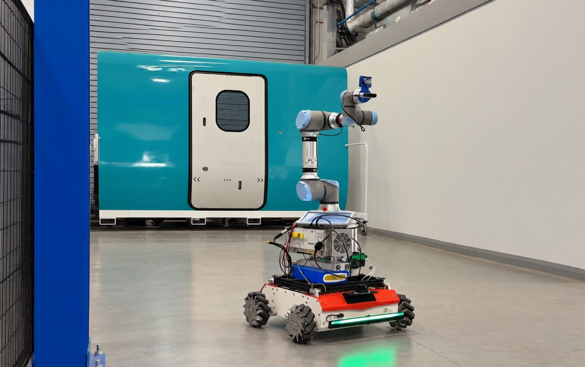
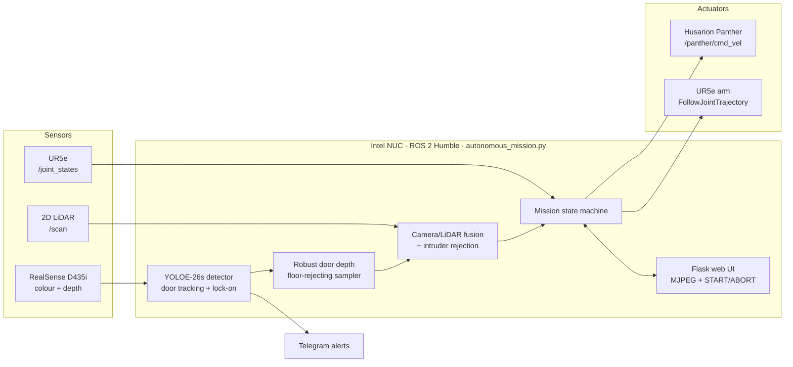
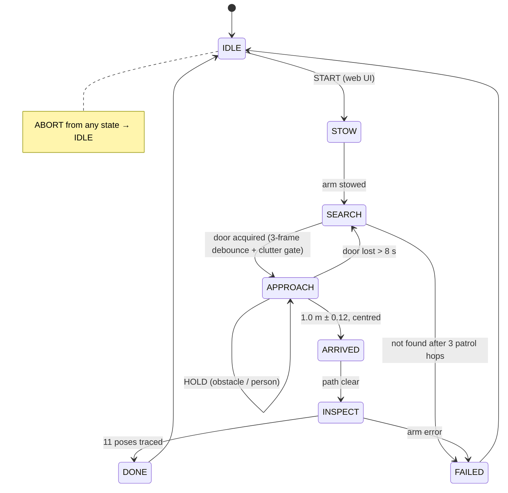
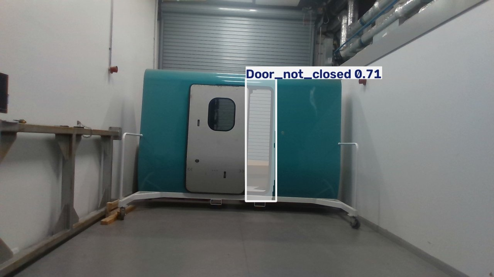
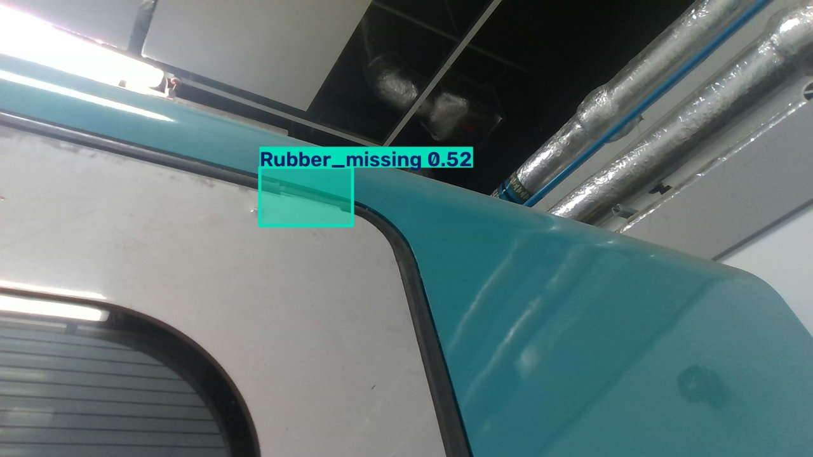
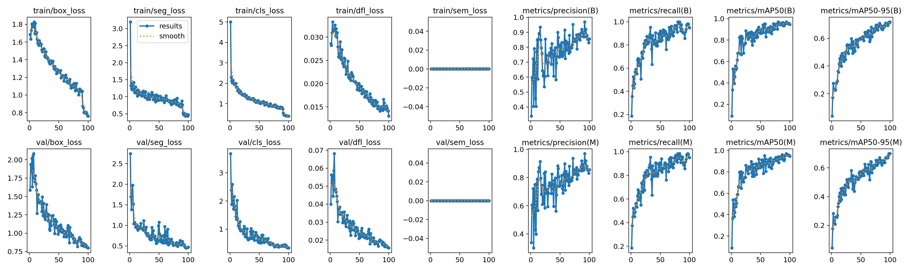
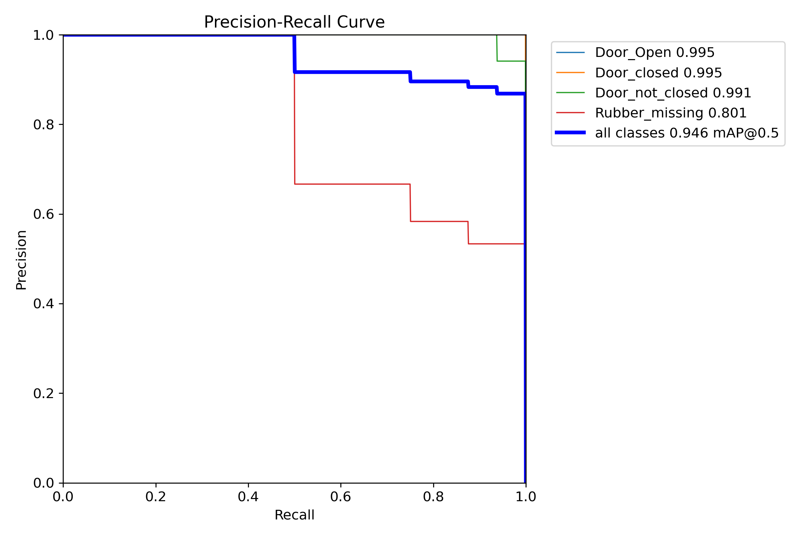
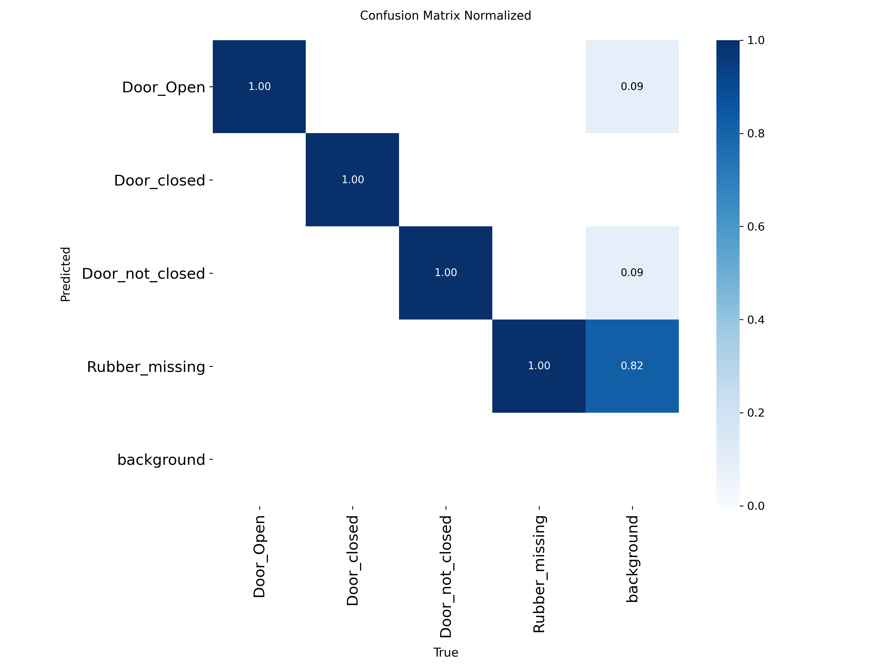
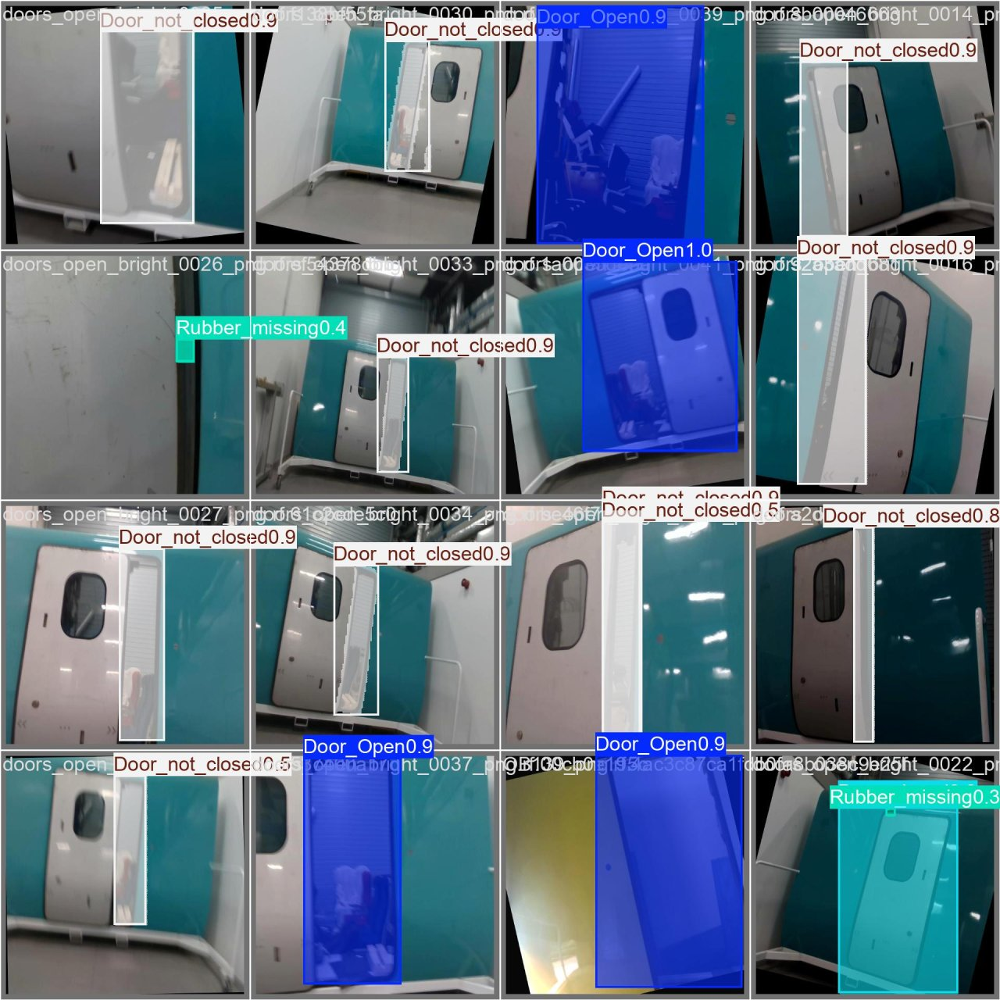

<div align="center">

# Autonomous Railway Door Inspection Robot

**A mobile manipulator that finds a train door, drives to it, and inspects it with a wrist-mounted camera, all without human control.**

[](https://github.com/ProfessorYaseen/railway-door-inspection-robot/actions/workflows/ci.yml)


<a href="https://drive.google.com/file/d/1VnWKkuYJ9Y3QAwAZMoL4Ko5KShj8-x4C/view?usp=sharing">
  
</a>

▶️ **[Watch the full autonomous run (video)](https://drive.google.com/file/d/1VnWKkuYJ9Y3QAwAZMoL4Ko5KShj8-x4C/view?usp=sharing)**

</div>

---

## Overview

Door faults are a leading cause of train delays, and every door is still checked by hand during depot maintenance. This project automates that check on a real robot:

1. **Search:** the robot rotates and patrols until a trained detector finds a train door.
2. **Approach:** it drives to exactly **1.0 m** from the door, fusing RealSense depth with 2D LiDAR and holding still if a person steps in.
3. **Inspect:** a UR5e arm sweeps a wrist-mounted camera around the door frame, pose by pose.
4. **Report:** defects (`Door_not_closed`, `Rubber_missing`, `Door_Open`) are sent to a phone over **Telegram** with an annotated photo. Every run is recorded, and the mission is controlled from a **web dashboard**.

Built and tested at the University of Huddersfield's **Institute of Railway Research** as part of a PhD on robotic inspection of railway rolling stock.

### Highlights

| | |
|---|---|
| 🎯 **0.946 mAP@50** | 4-class door-state detector (YOLOE-26s, 10.4 M params, 13.8 ms/img on a T4) |
| 🤖 **End-to-end autonomy** | search → approach → 11-pose arm inspection → report, from one START button |
| 📏 **±0.12 m standoff** | camera + LiDAR fusion that handles floor clutter, open doorways and people stepping in |
| 🛡️ **6 safety layers** | ABORT, LiDAR obstacle hold, intruder detection, minimum-distance hold, clear-path check before the arm moves, pendant Remote mode |
| ✅ **39 unit tests in CI** | the decision logic is pure Python and tested without any hardware |

---

## System architecture



### Mission state machine



---

## Hardware

| Component | Role |
|---|---|
| **Husarion Panther** (mecanum, 4WD) | mobile base, `/panther/cmd_vel` |
| **Universal Robots UR5e** | 6-DoF arm, `ur_robot_driver` + external_control |
| **Intel RealSense D435i** (wrist-mounted) | RGB + aligned depth, 640×480 at 30 fps for the mission |
| **2D LiDAR** (RPLIDAR) | obstacle fan (±22°) and straight-ahead range (±10°) |
| **Intel NUC** | onboard compute: ROS 2 Humble, detector, web server |

---

## Perception

### Classes

| Class | Meaning | Alert |
|---|---|:-:|
| `Door_Open` | door fully open | 📱 |
| `Door_closed` | door correctly closed | |
| `Door_not_closed` | door ajar / not latched (safety-critical) | |
| `Rubber_missing` | door-seal rubber missing (maintenance defect) | 📱 |

### Dataset

* **613 images** captured with the robot's own D435i on a full-size railway vehicle door mock-up, annotated in Roboflow.
* **52 hard negatives** (lab doors, cabinets, fences, with no train door) to stop the model detecting a "door" in every rectangle.
* Split **489 / 61 / 63** (train / val / test), stratified so hard negatives appear in every split.
* Box labels are converted to rectangle polygons, so one YOLOE *segmentation* model gives both boxes and masks.

The dataset is **not public** (institutional data). Details are in [docs/dataset.md](docs/dataset.md). The capture tool is [`scripts/capture_dataset.py`](scripts/capture_dataset.py).

### Results (validation split, 61 images / 58 instances)

| Class | Precision | Recall | mAP@50 | mAP@50-95 |
|---|:-:|:-:|:-:|:-:|
| Door_Open | 0.946 | 1.000 | 0.995 | 0.878 |
| Door_closed | 0.972 | 1.000 | 0.995 | 0.862 |
| Door_not_closed | 0.939 | 0.966 | 0.991 | 0.739 |
| Rubber_missing | 0.569 | 0.829 | 0.801 | 0.397 |
| **All** | **0.857** | **0.949** | **0.946** | **0.719** |

Model: YOLOE-26s-seg fine-tuned for 100 epochs (AdamW, lr 1e-3, mosaic + mixup) on a Tesla T4 in about 36 minutes. Exported to **OpenVINO FP16** for the NUC and **ONNX** for other machines. Mask mAP@50-95 is 0.699.

<table>
<tr>
<td></td>
<td></td>
</tr>
<tr>
<td align="center"><code>Door_not_closed</code>: the gap is localised, not the whole door</td>
<td align="center"><code>Rubber_missing</code>: close-up from the arm camera</td>
</tr>
</table>

<details>
<summary><b>Training curves, PR curve, confusion matrix, batch predictions</b></summary>

| | |
|---|---|
|  |  |
|  |  |

Full per-epoch log: [`assets/results/training_log.csv`](assets/results/training_log.csv). Hyper-parameters: [`assets/results/train_args.yaml`](assets/results/train_args.yaml).
</details>

---

## Engineering challenges solved

Each of these came from a failure seen in field tests. The full write-up is in [docs/engineering_notes.md](docs/engineering_notes.md).

| Problem seen on the robot | Root cause | Fix |
|---|---|---|
| Stopped at **1.5 m** instead of 1.0 m | Up close, the bottom of the door box is **floor**, and the near-depth sampler locked onto it | Skip the bottom 30% of the box and the bottom rows of the image; cross-check with LiDAR ([`perception.py`](src/door_inspection/perception.py)) |
| "Lost" the door at about 2 m | The door fills the frame, so the detector box drops out | Lock-on tracking with loose re-association, then a final drive-in on LiDAR |
| Open door: LiDAR sees **through** the doorway | The beam passes through the opening and reads several metres too far | When the door is open and LiDAR is much farther than the camera, trust the camera; never drive in blind ([`fusion.py`](src/door_inspection/fusion.py)) |
| A person walks between robot and door | LiDAR suddenly reads much closer than the tracked door | Debounced **intruder** detection, then HOLD until the path is clear |
| Lab cabinets detected as doors | Lots of door-like rectangles in the lab | Strict gate on acquisition only (confidence, size, aspect ratio, 3-frame debounce) plus hard-negative training data |
| Slow arm (6 s per pose) | Fixed trajectory time | Move time scales with the largest joint change, so small moves take about 2 s ([`arm.py`](src/door_inspection/arm.py)) |
| Camera hiccup made START do nothing | Vision thread died silently | Auto-restarting vision loop plus a one-off Telegram warning |
| Live video died when the cable was unplugged | UI was bound to the wired IP | The launch script detects the Wi-Fi IP and prints it |

---

## Repository structure

```
railway-door-inspection-robot/
├── robot/
│   └── autonomous_mission.py     # ROS 2 node: vision, state machine, web UI, alerts
├── src/door_inspection/          # hardware-independent core (unit-tested)
│   ├── perception.py             #   door gate + floor-rejecting depth sampler
│   ├── fusion.py                 #   camera/LiDAR fusion + intruder rejection
│   ├── arm.py                    #   UR5e poses + adaptive move timing
│   └── notify.py                 #   Telegram alerts (rate-limited)
├── scripts/
│   ├── start_robot.sh            # one command launches LiDAR + UR driver + mission
│   ├── run_inference.py          # try the model on images / video / webcam / RealSense
│   ├── capture_dataset.py        # collect training images on the robot
│   └── check_camera.py           # RealSense pre-flight check
├── training/
│   ├── train.py                  # prepare / train / eval / export CLI
│   └── train_door_detector.ipynb # same pipeline on Google Colab
├── tests/                        # 39 pytest tests, run in GitHub Actions
├── docs/                         # engineering notes, dataset, robot setup
└── assets/                       # images, training results
```

---

## Quick start

### 1. Try the detector (no robot needed)

```bash
git clone https://github.com/ProfessorYaseen/railway-door-inspection-robot.git
cd railway-door-inspection-robot
pip install -r requirements.txt
# download best.pt from the Releases page into weights/
python3 scripts/run_inference.py --weights weights/best.pt --source assets/samples
python3 scripts/run_inference.py --weights weights/best.pt --source 0 --show   # webcam
```

### 2. Run the tests

```bash
pip install pytest numpy requests pyyaml
pytest -v
```

### 3. Train your own model

```bash
python3 training/train.py prepare --data data/data.yaml
python3 training/train.py train   --data data/data.yaml
python3 training/train.py eval    --data data/data.yaml --weights <run>/weights/best.pt --split test
python3 training/train.py export  --weights <run>/weights/best.pt
```

Or open [`training/train_door_detector.ipynb`](training/train_door_detector.ipynb) in Colab.

### 4. Run on the robot

```bash
# on the Intel NUC (Ubuntu 22.04 + ROS 2 Humble)
cp .env.example .env && nano .env        # Telegram token, arm IP, model path
./scripts/start_robot.sh                 # then open http://<NUC-WIFI-IP>:5000 and press START
```

Full setup, including ROS packages, pendant steps and networking, is in [docs/robot_setup.md](docs/robot_setup.md).

---

## Limitations and next steps

* **`Rubber_missing` is the weak class** (precision 0.57). It is a small target, and most background false positives come from this class (see the confusion matrix). Next steps: more close-up seal images, higher input resolution for the arm camera, and failure-focused synthetic augmentation.
* **Small evaluation set** (61 validation images, one door type). Metrics show feasibility, not depot-scale performance.
* **Lab mock-up.** Depot trials on in-service vehicles are the next milestone.
* **Fixed arm poses.** These were taught for one door geometry. Future work replaces them with *uncertainty-driven next-best-view* planning, so the arm looks again only where the detector is unsure.

---

## Author

**Muhammad Yaseen**, PhD researcher in Computer Vision and Robotics, University of Huddersfield (Institute of Railway Research)

[GitHub](https://github.com/ProfessorYaseen) · [Google Scholar](https://scholar.google.com/citations?user=66HkvVsAAAAJ)

Acknowledgements: Institute of Railway Research, University of Huddersfield. Supervisors: Muhammad Hussain, Gareth Tucker, Hamid Raza Faham.

If this work is useful to you, please cite it using [CITATION.cff](CITATION.cff).

## License

[AGPL-3.0](LICENSE), matching the license of the [Ultralytics](https://github.com/ultralytics/ultralytics) framework this project builds on.
